<p align="center">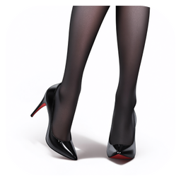</p>

<h1 align="center">丝袜纹理工具</h1>

<p align="center">中文 | <a href="README.en.md">English</a></p>

给插画里的丝袜加上真实的织物纹理。粗涂出丝袜在哪，沿横纹画几条线，工具就算出纹理怎样绕着腿和身体走，按你选的样式渲染出来，没有摩尔纹。全程在本机运行，不上传任何东西。

<p align="center">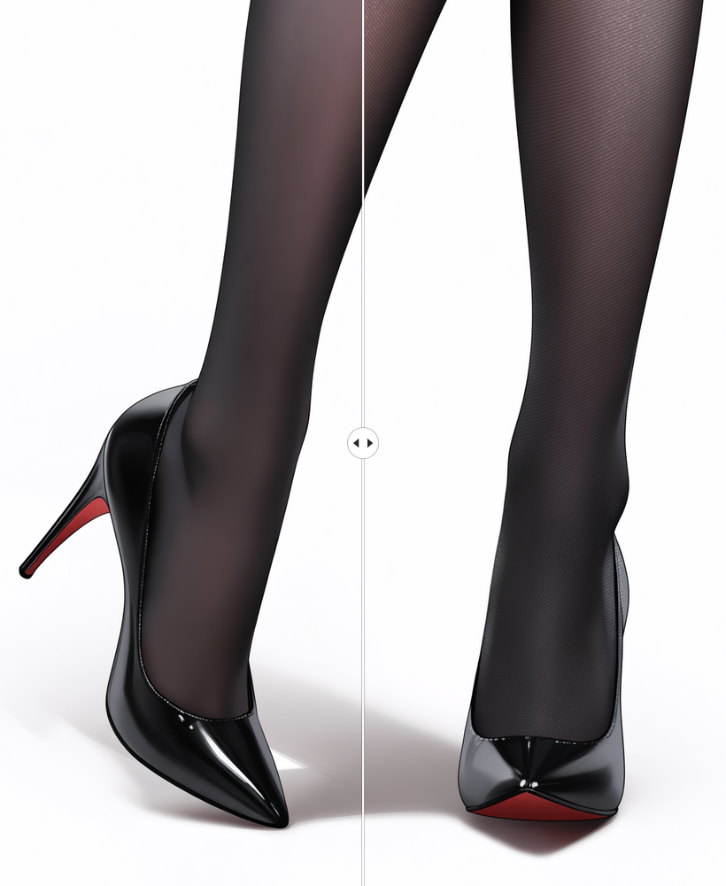</p>

<p align="center"><sub>对比拖杆左边是原图，右边是处理后。</sub></p>

白丝黑丝都可以（左边原图，右边处理后）：

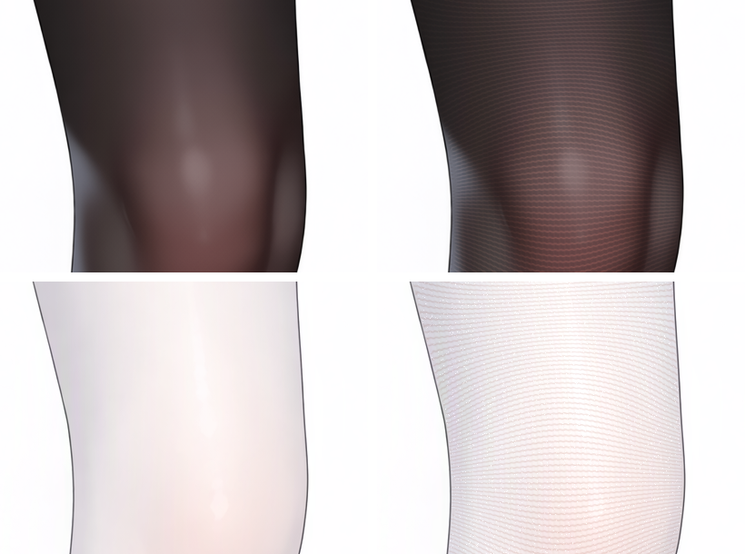

## 能做什么

- **几条线铺满整条腿。** 每个部位画 1–3 条线告诉它横纹往哪走，横纹自动铺满，在屏幕上处处等距。手、头发挡住的地方，横纹在下面连续走。
- **点一下选出一条腿。** 点选用 Segment Anything，点完可以在小 / 中 / 大三档范围里挑。
- **六种样式：** 细线、针织、线圈、斜单线、加濑风、油光（试验）。每种都能加纱线反光的亮点。
- **纹理层（试验）：** 最多把四种纹理按百分比叠在一起，比如细线 30%、加濑风 70%，都按同一套走向线画。
- **高光粒子（试验）：** 像油光那样顺着受光处找出整条腿的高光带，画成细密的粒子而不是平滑光带，可以叠在任何样式上。
- **预设：** 调好的样式、密度、斜度、强度、纹理层、亮点、高光粒子和摩尔纹效果可以存成预设，换一张图一键读取，也能导出成小文件发给别人。
- **白丝黑丝都行。** 强度按丝袜深浅自动设定：同样的纹理在白丝上显眼一倍，白丝会自动调低。
- **不出摩尔纹。** 横纹太密、接近像素大小的地方，纹理会自动减弱；「标出问题」会把这些地方标出来。
- **想要摩尔纹时有个试验开关。** 真丝袜叠穿、拍照时那种水波似的明暗条纹，打开「摩尔纹效果」的开关，再用「明暗」调条纹的明暗差别、「面积」调它从一小圈扩到多大。默认关；条纹顺着膝盖、大腿这些鼓起的地方走，平的地方没有。
- **左右一键镜像。** 左腿画好，右腿点一下就有。
- **四种导出：** 成品图 PNG；仅丝袜 PNG（透明底，可在 Photoshop 里当一层叠在原图上）；仅纹理 PNG（用「线性光」叠在原图上）；丝袜引导 PSD（以后可以再打开接着改）。你自己的 PSD 永远不会被改写。
- 中文 / English 界面。2K、4K 屏上字太小时，右上角的「界面大小」可以放大到 115%–175%。

## 安装

需要 Windows 10（1803 以上）或 Windows 11。有 NVIDIA 显卡（RTX 20 系或更新、驱动 570 以上）会快很多，没有也能用。

1. 下载这个仓库：点右上角 **Code → Download ZIP** 解压，或者

   ```
   git clone https://github.com/silvermoong/stocking-texture-tool.git
   ```

2. 双击文件夹里的 `install.bat`。Windows 可能提示「无法验证发布者」或「Windows 已保护你的电脑」，点「运行」，或者「更多信息 → 仍要运行」。

   文件夹的完整路径不要太长（100 个字符以内），比如放在 `D:\stocking-texture-tool`。

安装程序会检测显卡，从本项目 GitHub 上的[安装文件包](https://github.com/silvermoong/stocking-texture-tool/releases/tag/deps-1)下载需要的文件：一个独立的 Python 3.12、全部依赖、对应显卡的 PyTorch 和两个模型。最后在桌面建一个「丝袜纹理工具」快捷方式。电脑上不需要事先装 Python，也不会动你已有的 Python。显卡版要下载约 3.3 GB，CPU 版约 740 MB，装完显卡版约占 5 GB。

GitHub 下载失败的文件，会改从各自的原始来源下载（PyPI、PyTorch、Hugging Face 等）。

装好后双击桌面图标打开。也可以把图片或 PSD 直接拖到图标上。

- 中途断网了，重新运行 `install.bat` 即可，已经下载的部分不会重复下载。
- **更新：** 再运行一次 `install.bat`。它会先把代码更新到 GitHub 上的最新版（下载 ZIP 的直接替换有变化的文件；`git clone` 的用 git 快进，不会覆盖你自己改过的文件），再补装新版需要的依赖和模型。连不上 GitHub 时照常安装手上的代码。不想更新：`install.bat -NoUpdate`。
- 更新显卡驱动后再运行一次，会从 CPU 版换成显卡版。
- 想强制用 CPU：`install.bat -Torch cpu`。
- **卸载：** 删掉这个文件夹和桌面快捷方式。设置和自动保存的工作在 `%LOCALAPPDATA%\StockingTexture`，也可以一起删。

### 离线安装

安装文件包下载太慢，或者安装的电脑不能联网时，先在别处把文件下好：

1. 打开[安装文件包](https://github.com/silvermoong/stocking-texture-tool/releases/tag/deps-1)，下载 `stt-deps-1-base.zip`，再按显卡选一种 PyTorch：
   - NVIDIA 显卡：`stt-deps-1-torch-cuda.zip.001` 和 `.002`，两个都要
   - 其他电脑：`stt-deps-1-torch-cpu.zip`
2. 在 `install.bat` 旁边新建一个 `deps` 文件夹，把下载的文件原样放进去。**不用解压，也不要改文件名**，安装程序会自己拼接、校验和解压。
3. 双击 `install.bat`，全程不用联网。

## 使用

点顶栏的 `?`，或按 `?`（`Shift+/`），打开只读的快捷键与鼠标手势速查表。不用先打开图片。再按 `?`、按 `Esc`、点「关闭」或点弹窗外都能关掉。引导页的空格用于按住拖动画面；纹理页的空格用于按住查看细节原图，松开恢复效果。用键盘聚焦在按钮等控件上时，空格仍归那个控件（例如按下按钮）；先把焦点移到画面（可用「跳到画面」）或细节预览，再用这两个手势。

### 1. 打开图片

把 PNG、JPG 或 PSD 拖进窗口，或者按 Ctrl+O。PSD 取合成后的画面。打开图片前，左侧面板不可操作，也不会接收键盘焦点。

### 2. 涂部位

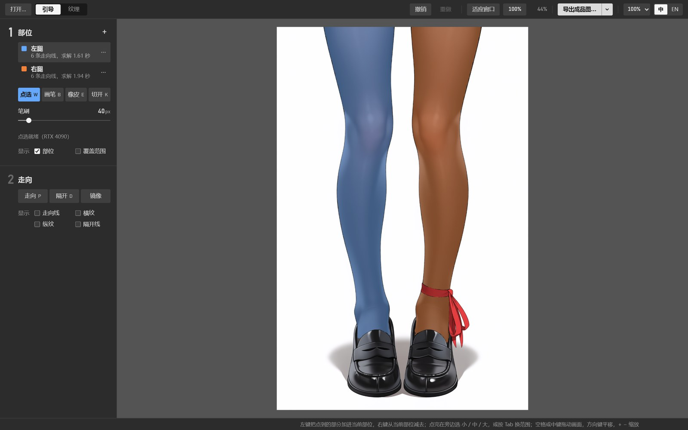

左边第 1 步「部位」。默认已经有「左腿」「右腿」两个部位。把鼠标移到工具按钮上，或用键盘聚焦按钮，都能看到它的用法。

- **点选（W）：** 在腿上左键点一下，整条腿就选进来；右键减去。点完旁边会出现「小 / 中 / 大」，按 Tab 切换范围。漏掉的地方用小档再点一下补上；几次点选拼在一起时，各块中间被线稿隔开的细缝会自动补上（范围旁边的「补细缝」开关可以关）。
- **画笔（B）/ 橡皮（E）：** 手动修边，`[` `]` 调笔刷大小。
- **切开（K）：** 在部位上画一条线，分成两块。画面上方会出现「自动贴线」开关，打开后线会吸到附近的线稿上。两胸或两条腿选在了一起，点那里的「自动分割」，会沿中线分开。切开、走向或隔开时，线画得太短，底部会提醒拖长一点。

凡是有折痕的地方，两边各用一个部位：左右大腿、胯部、左右胸。腿以外也一样能用，比如一件上衣切成领子、左胸、右胸三块：


### 3. 画走向线

左边第 2 步「走向」，选「走向（P）」，沿着你想要的一道横纹画一条线。横纹是绕着腿一圈一圈的线，所以在腿上画的是横穿过腿的弧线，像腿上套着的环看得见的那半圈。

- 每个部位 1–3 条就够，每条横跨部位宽度的大约八成。
- **线只管方向，不管疏密。** 画得密还是稀都一样，横纹间距由纹理页的「密度」决定。
- 方向变化大的地方各补一条。凸起的地方（膝盖）上方画 ∩、下方画 ∪，把它包住；凹进去的地方（脚踝正面）反过来，上方 ∪、下方 ∩：

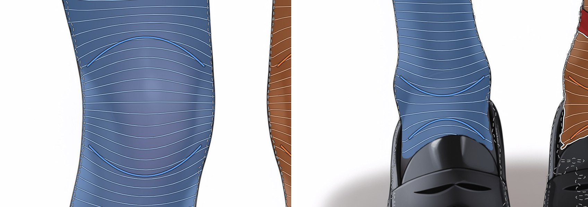

- 线可以横穿手或头发，横纹会在下面接着走。
- 右键或 Delete 删掉指针下的走向线；右键点空时，底部会提醒把指针移到走向线上。每画一条只重算这一个部位，一两秒就好。
- **镜像：** 左腿画好后，选中左腿点「镜像」，右腿就有了一套翻转过来的线，之后可以照常修改。自动配对时，底部会写明从哪个部位镜像到哪个部位，以及替换了几条走向线（如果有）。按 Ctrl+Z 可以撤销。

两条腿画好走向线后，白色细线是算出来的横纹：

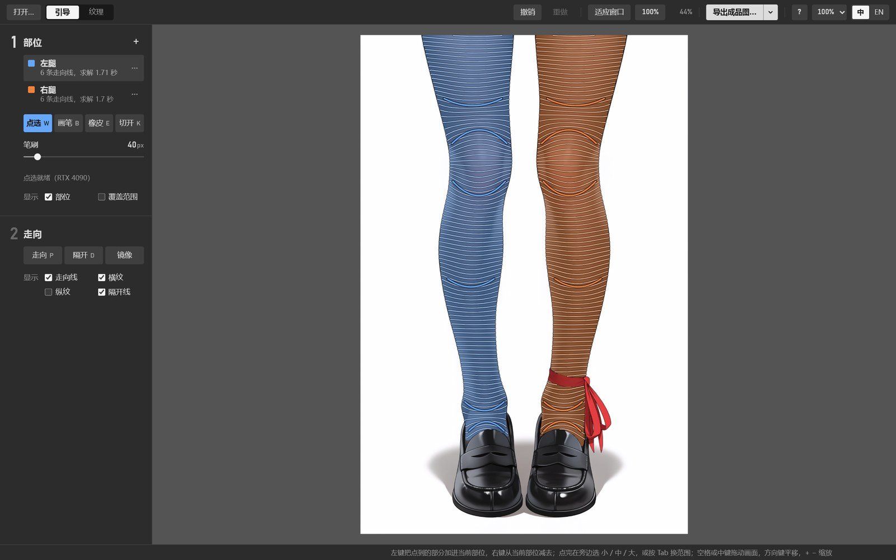

上衣也一样，横纹顺着胸部的弧度弯曲：

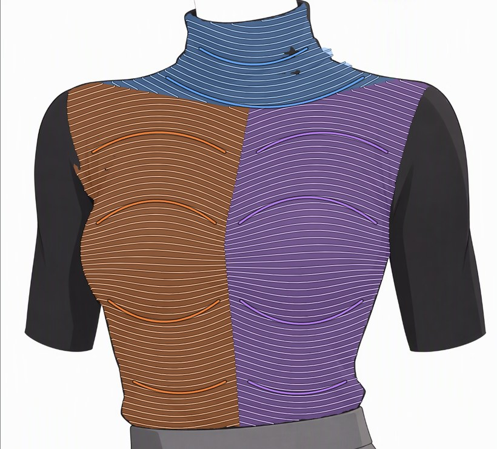

### 4. 弯折的腿

一条腿弯折、大腿压着小腿时，用一个部位就够，膝盖处没有接缝。大腿和小腿各画一条走向线，再按下面两步处理交界和膝盖。

只画两条走向线时，大腿的横纹会直接串进小腿：

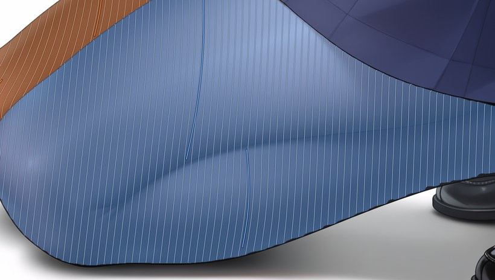

**大腿和小腿各走各的：** 用「隔开（D）」沿大腿和小腿贴在一起的交界画一条线（画面上方的「自动贴线」打开时，线会吸到附近的线稿上）。两边的横纹在交界处分开，大腿和小腿可以画不同方向的走向线。


**膝盖处平顺过渡：** 在膝盖上再画一条弧线，大致放在膝盖中间，弧度和膝盖的弯折一样。横纹会沿着它绕过膝盖，把大腿和小腿两种方向平顺地接起来。


按这三步处理后（细线样式，原图像素）：

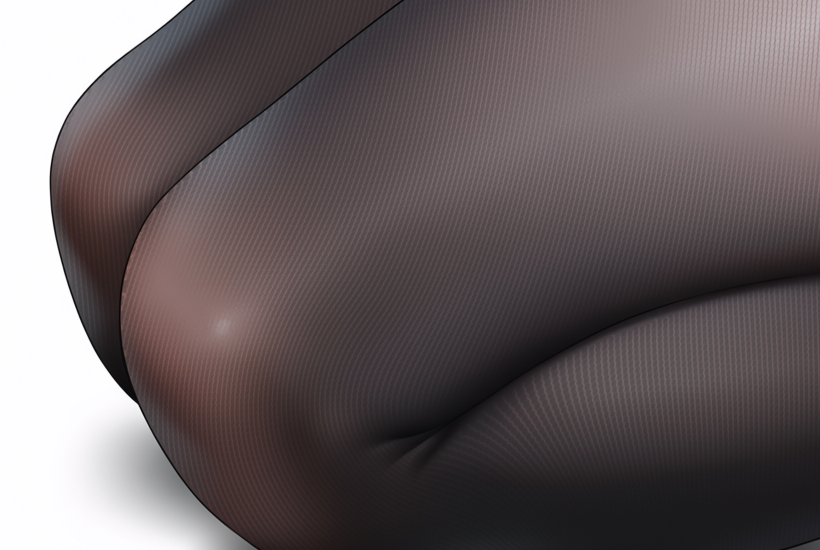

左边原图，右边处理后。膝盖处的横纹沿弧线绕过去：

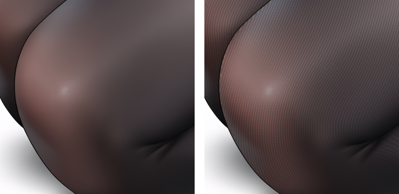

大腿和小腿的交界，两侧的横纹方向不同：

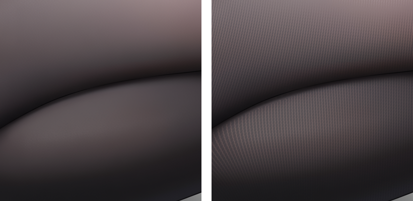

同一个部位里，一块丝袜挡在另一块前面、深度上有明显落差的地方，工具会尽量自动找出隔开线，显示为虚线；找错了右键删掉。贴在一起的交界一般找不到，要自己画。

### 5. 选样式、调参数

切到顶部的「纹理」页。参数面板在预览旁，窄窗口里在预览下方。「整体」看全图（拖中间的对比拖杆看原图和效果），「细节」放大到 100% 或 200%，拖滑杆时实时更新。细节里看到的就是导出的像素。预览失败时，底部会标明「整体」或「细节」；下一次更新成功后提示会消失。

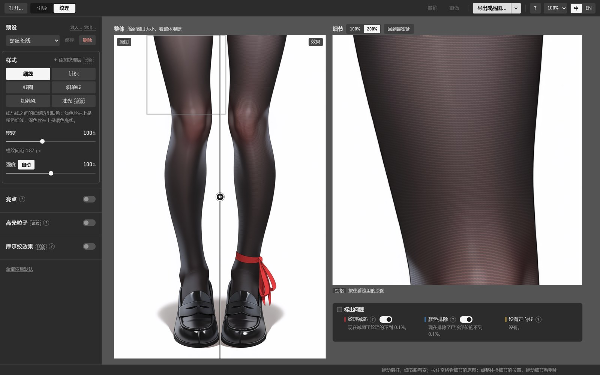

**样式**，从左到右：细线、针织、线圈、斜单线、加濑风、油光。上黑丝，下白丝（油光是给深色丝袜用的，白丝那行没有放）：

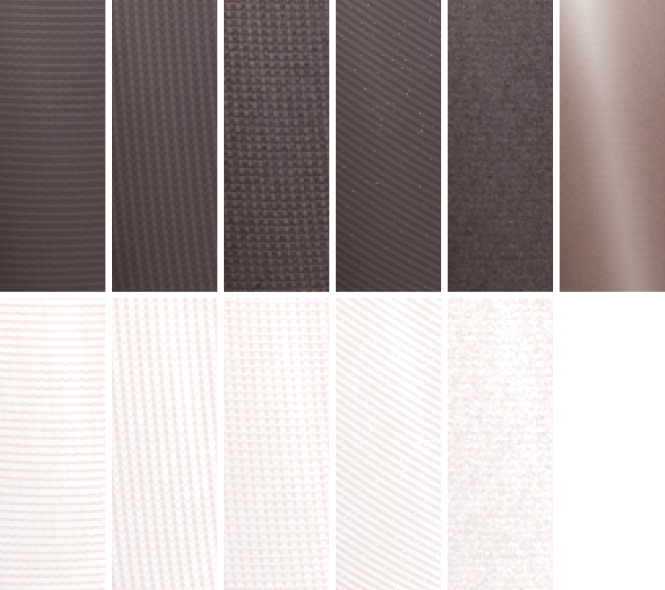

| 样式 | 样子 |
| --- | --- |
| 细线（默认） | 宽纱线之间一道细缝透出肤色：浅色丝袜上是粉色细线，深色丝袜上是暖色亮线（按每个部位整体的深浅判断，所以一条腿黑丝、一条腿白丝也行） |
| 针织 | 一列列 V 形线圈，像丝袜脚底加厚部分的织法 |
| 线圈 | 整齐的线圈针织：按真实平针的纱线走法画出每个线圈，每个线圈都一样，行列笔直。随透肤程度变化，和画师原图一样：透出肤色的亮处是清楚的线圈，不透肤的暗处渐渐变成粗糙的细颗粒，对比也跟着减弱。适合画画时当底纹 |
| 斜单线 | 斜着走的细线，两条腿方向相反，成人字形 |
| 加濑风 | 细碎的颗粒感针织 |
| 油光（试验） | 半透明的油亮丝袜：正对处透肤、深色丝袜的边缘发黑、受光处一道宽而柔的连续反光带（反光的形状和黑边都照真实油光黑丝的商品图做的，反光自动沿着腿看上去的中间；画面里明确画在别处的高光照旧）。深色丝袜上这条反光会一直延续到整条腿：画里的高光变暗或完全没画的地方，会自动补一条淡淡的光线（跟着画出来的高光走，没画就走腿的中线），被丝带、头发隔开的同一条腿也连得上。适合纯色黑丝，换一张图效果可能不稳定 |

**滑杆**，每张都是同一块大腿：

密度 70% / 100% / 130%：横纹的疏密

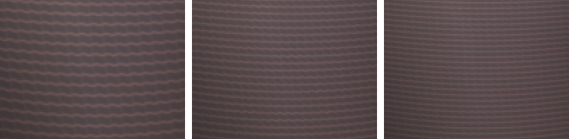

强度 50% / 100% / 160%：纹理有多明显，不影响亮点（亮点由下面的亮点滑杆单独控制）。默认「自动」，按丝袜深浅设定；深色衣服可以手动调高

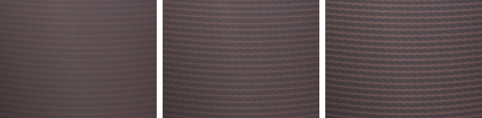

斜度 10° / 32° / 55°：只在斜单线样式里出现

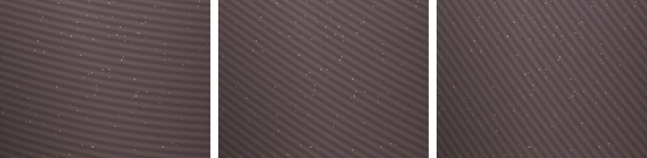

亮点（默认关，打开开关后出现滑杆；均匀分布）0% / 100% / 300%

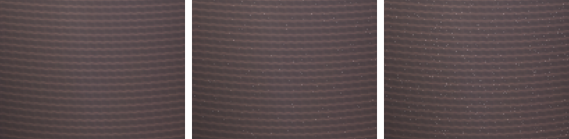

亮点有几个来源，可以混用：「按深度」撒在鼓起的地方（膝盖、腿正面），「按画面亮部」撒在画好的高光上，「均匀分布」到处都撒，适合亮片丝。

**高光粒子**（试验，默认关）：像油光那样顺着画面里的受光处找出连续的高光带（深色丝袜上同样会延续到整条腿），但把高光画成细密的粒子而不是平滑光带——中心密集、往两侧和首尾渐渐散开淡化，原有的平滑高光也会被拆出颗粒感。打开开关后用「亮度」调粒子有多亮，可以叠加在任何样式上。

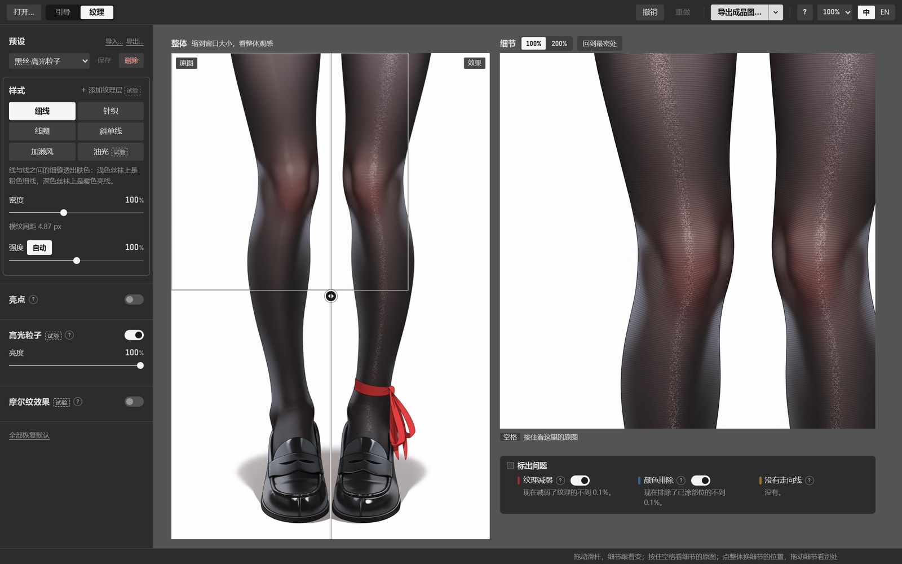

亮度 0% / 35% / 70% / 100%（从左到右），同一条左大腿到膝盖：顺着高光线一点点浮现出细密的粒子，往两侧渐渐散开淡化


**摩尔纹效果**（试验，默认关）：给丝袜加上一圈圈水波似的明暗条纹，像现实里丝袜叠穿、拍照时出现的摩尔纹。面板里有个滑动开关，打开后下面才出现两个滑杆：「明暗」是条纹的明暗差别有多大；「面积」是从每个鼓起处顶上的一小圈开始，一圈圈往外扩，环数也跟着变多，拉满就是整个鼓起的地方都有。条纹顺着深度模型估出的鼓起走，膝盖、大腿、胸顶各围成一圈圈，平的地方没有（拉满时大约六成的丝袜面积有条纹，其余是平处）；每圈对应固定的一段高度，所以鼓得越高环越多，位置和疏密不用管。关掉开关，两个滑杆收起来，条纹就没了，再打开时滑杆还停在原来的位置。六种样式都能用。这是特意加上的效果，纹理本身仍然不会出摩尔纹。

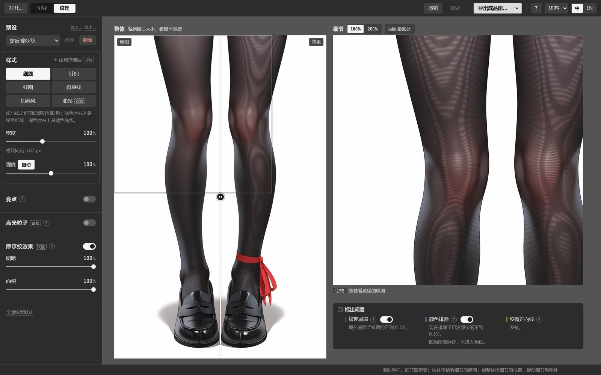

面积 35% / 50% / 70% / 100%（明暗 100%，左上、右上、左下、右下），同一块大腿：条纹从一圈开始往外扩，环数也跟着变多

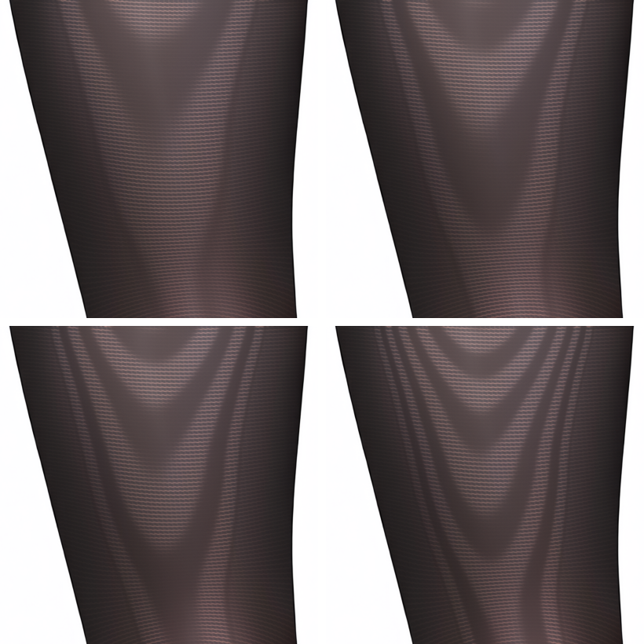

**纹理层**（试验）：把几种纹理叠在一起，比如细线 30% 加加濑风 70%。每一层都按同一套走向线画。

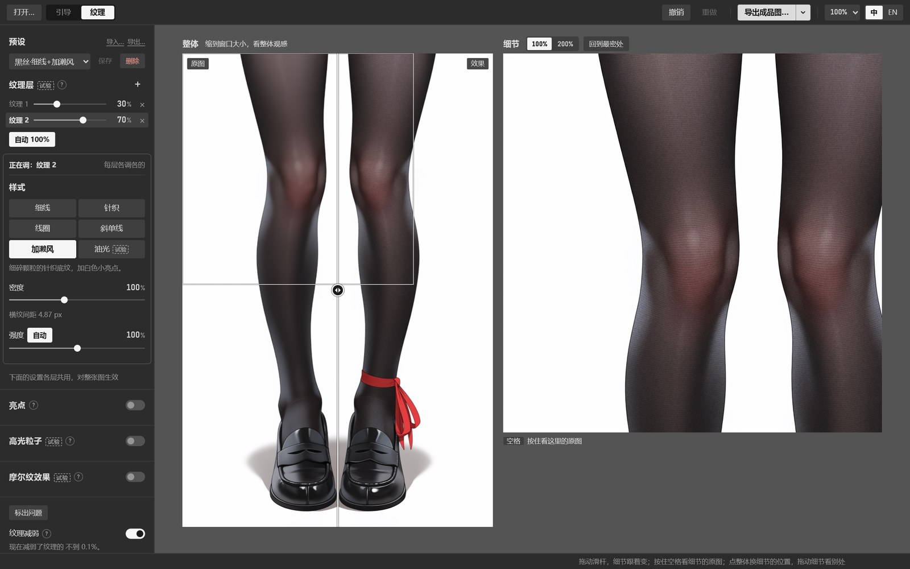

- **加层：** 纹理层都在纹理页的左面板里管，顶栏只有「引导」「纹理」两个页面。只有一层时，面板里「样式」标题旁有「+ 添加纹理层」，点它加一层，最多 4 层。有两层以上时，预设下面出现「纹理层」列表，每层一行（纹理 1、纹理 2……），「+」移到列表标题右边，满 4 层后变灰，并说明最多 4 层。行尾的「×」（或选中层名按 Delete 键）删掉那一层。
- **每层自己的设置：** 样式、密度、斜度和强度是每层各有一份，都在列表下面的框里。点层的名字，框里就切到那一层，框的第一行写着正在调哪一层。框下面的亮点、高光粒子、摩尔纹效果，以及预览旁「标出问题」那一组里的纹理减弱和颜色排除，对整张图生效。
- **融合：** 列表里每层一根百分比滑杆，不用切换就能直接调任何一层的比例。
- **自动 100%**（列表下面的按钮，默认开）：开着时各层加起来固定 100%，拖一层，其他层按原来的比例让出剩下的，纹理的总强度不变，新加的层和别的层平分。关掉后每层各调各的，互不影响，每层从 50% 开始：加起来超过 100% 纹理更重，不到 100% 会露出原图，合计显示在按钮右边。开和关各自记着自己的设置，来回切换不会丢；停在哪一边也会被记住，新打开的图按你最后的选择开始。鼠标停在按钮上有简短说明。
- **融合之后：** 亮点、高光粒子和摩尔纹效果在融合之后统一加一次，不在每层里重复算；亮点的形状跟第一层的样式走。
- **注意：** 几层叠在一起，对比度会比单层略低（两种纹理的线不重合，会互相冲淡）；层数越多，预览越慢。预设和「全部恢复默认」也包括纹理层。

加濑风的占比 0% / 30% / 70% / 100%（其余是细线，从左到右），同一条左大腿到膝盖：横线一点点被颗粒取代


**预设**（面板最上面）：把调好的样式、密度、斜度、强度、纹理层、亮点、高光粒子和摩尔纹效果存起来，以后在别的图上一键读取。在下拉里选一个就读取；调过之后点「保存」，就把现在的设置更新进选着的这个预设。设置与预设一致时，「保存」变灰并提示先改动再保存。想存成新的，选下拉最下面的「保存为新预设…」起个名字（没选预设时点「保存」也一样）；「删除」删掉选中的那个。预设存在这台电脑上，不跟图走；强度是「自动」的话，读取后会按这张图的丝袜深浅重新设定。读取会换掉现在的设置，按 Ctrl+Z（或顶栏的「撤销」）可以回去，下拉里选中的预设也一起退回；调过之后想回到预设原样，点旁边的「还原」。部位和走向线是每张图自己的，不在预设里。

**导出和导入预设：** 想把调好的预设发给别人，选中它，点标题右边的「导出…」存成一个小文件（`.json`）；对方点「导入…」选这个文件，它就出现在对方的预设里。导入的预设如果和已有的重名，会在名字后面加个序号（比如「黑丝 (2)」），不会覆盖对方自己的。文件里只有样式、密度、斜度、强度、纹理层、亮点、高光粒子和摩尔纹效果这些设置，不含图片和走向线。

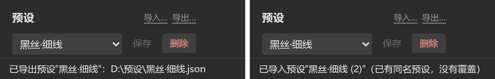

**颜色排除**（默认开，在预览旁「标出问题」那一组里）：部位里颜色和丝袜差得远的地方（金边、手套、露出的皮肤）不加纹理。薄丝袜透肤的膝盖偶尔会被误排除，这时把它关掉。这个开关随当前图的工作保存，不进入预设，也不会被「全部恢复默认」重置。

**撤销和重做：** 右上角的「撤销」「重做」（Ctrl+Z、Ctrl+Shift+Z 或 Ctrl+Y）管当前这一页，每一页各有自己的记录。鼠标悬停或用键盘聚焦按钮时，提示会写明当前页。在纹理页，它们管这一页上的操作：样式、密度、斜度、强度，加层、删层和各层比例，亮点、高光粒子、摩尔纹效果，读取预设、全部恢复默认，还有颜色排除的开关；拖一次滑杆算一步。预设库里的保存、删除、导入、导出不在其中。引导页的撤销仍然管部位和走向线。撤销记录不跟图保存，关掉图就清空。

### 6. 标出问题

勾上预览旁的「标出问题」，两个预览都会显示标记（只在预览里显示，不会导出）。它和下面三行是一组，工具把这一组排在预览区里，具体在哪一幅预览的下方或旁边，看图片和窗口的形状；窗口小的时候，可能要把预览区往下滚一点才看全。

每一行行首的小色条就是预览上的颜色：

- **红色**是横纹太密、为了不出摩尔纹被减弱的地方，由这一行的「纹理减弱」开关决定。
- **蓝色**是「颜色排除」去掉的地方，由这一行的开关决定。
- **黄色**是涂好了但不生成纹理的地方：部位没有走向线、求解失败，或部位里分开的一块没有线。它没有开关，要回引导页检查这些部位的走向线；这一行会写出是哪些部位，写不下时点旁边的「?」看全。

两个开关不勾「标出问题」也能调，并且会改变导出结果；每行下面写着它现在占已涂部位的多少。色条一直是这一行的颜色：没勾「标出问题」，或那一行的开关关着时是暗的，标在预览上时变亮。两个开关各自紧跟在自己的名称后面。用 Tab 聚焦到勾选框或开关后，空格是切换它；用鼠标点过之后，空格仍是按住看细节原图。

主要区域有大块红色，就把密度调低（有几层纹理时，降横纹最密的那一层）：

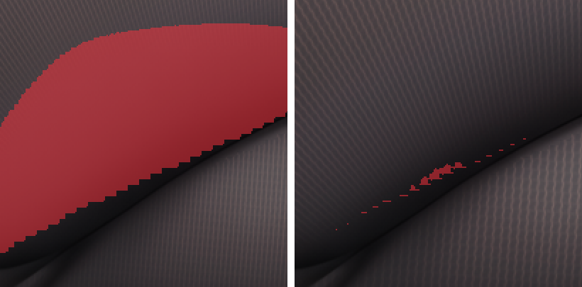

小图（比如 832×1216）横纹间距很快会碰到 3.2 px 下限。这时密度读数会同时显示设定值和实际生效值，下方也会提示这张图的上限。想要更密，先把图放大 1.5 倍再处理。

### 7. 导出

点右上角的「导出成品图」。旁边的箭头里可以选另外三种导出；文件写出成功后，主按钮才记住这种导出（Ctrl+E 与主按钮相同）。取消或写出失败不会改变它。每次导出都会弹出文件对话框，自己选位置、起文件名：一开始在原图旁边，之后在上次导出的文件夹；建议的文件名见下表，这个名字已经有文件了就自动加 (2)、(3)，所以连着导出几个方案不会互相覆盖。选了已有的文件，会先问你要不要替换。

| 导出 | 建议的文件名 | 用途 |
| --- | --- | --- |
| 成品图 | `原名-丝袜成品.png` | 直接用 |
| 仅丝袜 | `原名-仅丝袜.png` | 只有丝袜，其余透明。叠在原图上就等于成品图，在 Photoshop 里当一个图层，可以再调不透明度、加蒙版 |
| 仅纹理 | `原名-仅纹理.png` | 只有纹理，铺在中性灰（128）上，没有纹理的地方就是灰色。图层混合模式设成「线性光」叠在原图上就等于成品图；调不透明度就是调纹理强度，自己重涂丝袜后叠上去，纹理也跟着在。纹理是按原图算出来的，丝袜颜色改得越多，效果和工具里的差得越多 |
| 丝袜引导.psd | `原名-丝袜引导.psd` | 部位、走向线、隔开线都在里面，以后把它拖进工具就能接着改 |

工具会自动保存当前的工作，关掉再开从上次的地方继续。打开新图之前，如果当前的部位和走向线还没导出，会提醒你先导出丝袜引导.psd。

## 常见问题

**横纹从两块丝袜的交界处连了过去。** 用「隔开（D）」沿交界画一条线。

**纹理太淡或太明显。** 调「强度」。深色衣服、深色丝袜在默认强度下可能偏淡。

**勾上「标出问题」后有大块红色。** 降低密度，或者把图放大后再处理。

**点选用不了。** 第 1 步的笔刷下面会显示点选的状态和原因。模型文件缺失时，重新运行 `install.bat`。

**没有 NVIDIA 显卡能用吗？** 能。点选每张图要先分析两三秒，深度估算一两秒，其他和显卡版一样快：横纹求解和渲染本来就在 CPU 上。

## 原理

- **横纹从哪来：** 把你画的线的方向在整个部位里平滑插值成方向场，再解一个最小二乘问题，得到一个梯度处处为 1 的坐标场。横纹就是它的等值线，所以在屏幕上等距，方向跟着你的线走。手和头发造成的洞在求解时被填平，所以横纹在遮挡物下面是连续的。
- **贴合身体：** 纹理是乘在原画上的，完整保留画师画的明暗；细线、针织的缝隙颜色按周围丝袜的深浅决定，透肤的地方自然变化；亮点按深度撒在鼓起的地方。
- **不出摩尔纹：** 每一层条纹在它的局部频率接近像素极限前就淡出；线圈等小图案用预先平均过的多级贴图采样，太密时平均成灰色而不是乱纹；亮点是随机的单个像素。
- **多层叠加：** 每一层单独渲染一遍（原图加上这一层的纹理），再逐像素按百分比混合：自动 100% 开着时是加权平均，关着时是原图加上各层纹理各自的量。丝袜以外每一层都等于原图，混完仍是原图。
- **深度模型** 用来自动找一块丝袜挡在另一块前面的轮廓，以及决定「按深度」的亮点和「摩尔纹效果」的条纹放在哪。

## 第三方组件

安装时会下载这两个模型，不包含在仓库里：

- [Segment Anything](https://github.com/facebookresearch/segment-anything) ViT-B（Meta，Apache-2.0）：点选
- [Depth Anything V2 Small](https://huggingface.co/depth-anything/Depth-Anything-V2-Small-hf)（Apache-2.0）：深度估算

另外用到 PyTorch、Transformers、OpenCV、NumPy、SciPy、psd-tools、FastAPI 等，安装由 [uv](https://github.com/astral-sh/uv) 完成。

## 开发

```
.tools\uv pip install --python .venv\Scripts\python.exe -r requirements-dev.txt
.venv\Scripts\python -m pytest
```

一部分测试要用一张样图，它不随仓库发布，没有时这些测试会自动跳过，见 [tests/sample_data.py](tests/sample_data.py)。

改了依赖版本（`requirements*.txt`）之后，要重新打包安装文件包：`.venv\Scripts\python tools\make_deps.py deps-2`，把生成的文件上传到新的 GitHub Release `deps-2`，再提交并推送更新后的 `tools/deps.json`。顺序不能反：用户运行 `install.bat` 时会立刻拿到新代码，并按新的 `deps.json` 下载。

`tools/commit.txt` 由 GitHub 在生成代码 ZIP 时写入提交号（`.gitattributes` 里的 `export-subst`），`install.bat` 靠它判断 ZIP 版是否需要更新，不要改它。

### 界面验证

[界面回归](tests/test_ui_browser.py)用 [uibrowser.py](tests/uibrowser.py) 起隔离的真后端，再用无头 Edge 和临时浏览器配置打开真实页面。测试图由程序生成，不读取你的图片或设置，也不加载模型。没有 Edge（也未通过 `STOCKING_EDGE` 指定其他 Chromium 浏览器）或缺少 `websockets` 时，浏览器用例会跳过；`-rs` 会列出理由。辅助的单测不需要浏览器。

```
.venv\Scripts\python -m pytest -q -rs tests/test_uibrowser.py tests/test_ui_browser.py
```

- **截图预算。** 单次运行（一个 Python 进程，所有浏览器和标签页合计）最多写 8 张 PNG。每张保留视口原尺寸；宽或高超过 1600 像素时拒绝写入并报错。首次超出张数会提示，超额的 `page.screenshot()` 返回 `None`，测试断言照跑。默认写到 Git 忽略的 `out/ui-browser`。取证时用 `-k` 只跑需要看的情景，另选一例窄屏（如 360 像素）；可将 `STOCKING_UI_SHOTS` 指向新的忽略目录，以免混入以前的截图。
- **异常自报。** `page.close()` 会汇总未捕获的 JS 异常、`console.error`、HTTP 5xx 和未取消的网络失败，有问题则断言失败。用例共用标签页时，在操作完成后调用 `page.check_errors()`，限时读出并清空本段诊断，不把它们留给下一段；已发生的用例失败不会被收尾报告盖掉。故意触发的错误用 `page.check_errors(allow={'console.error: expected test failure'})` 按完整诊断行放行，只对本次检查有效。自报不把 4xx 响应本身当成错误，也看不到只在 JS 内替换 `fetch` 产生的模拟响应；检查点不等还没发生的请求或定时器。
- **验证边界。** 无头环境不覆盖真实桌面窗口、系统弹窗、用户数据、模型、高分屏或其他浏览器。截图或自报没问题，不代表文字、数据、交互流程正确，也不证明按钮没被遮挡。对需要交互的控件，用真实的指针或按键操作并断言结果；布局、遮挡和视觉效果要查看实际截图，必要时连同源码或差异一起核对。

## 许可

代码用 [MIT 许可证](LICENSE)。README 里的示例图是作者自己生成的。
